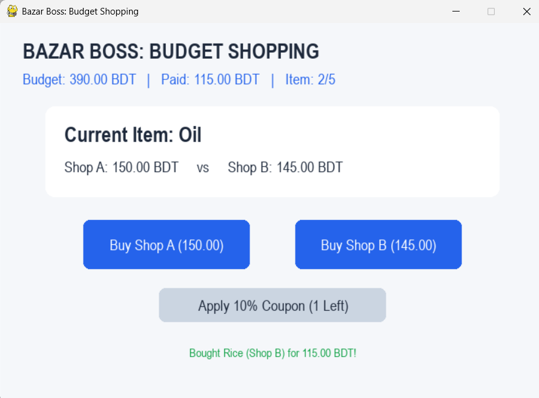
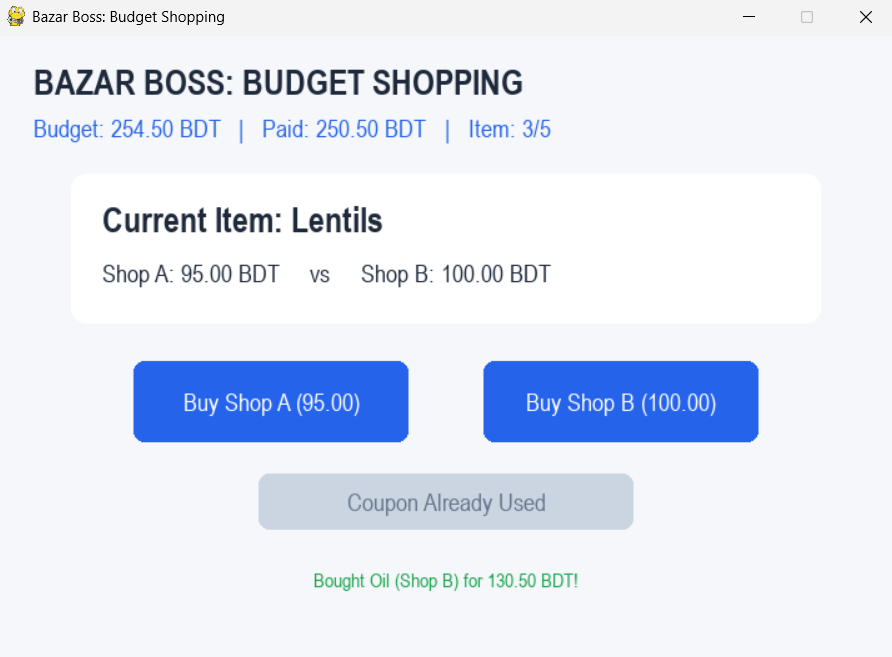
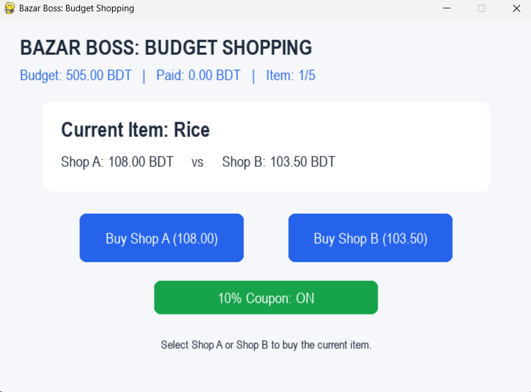

# Bazar Boss: Budget Shopping

A Python budget-management and price-comparison game where players must purchase five essential grocery items without exceeding a fixed budget of **505 BDT**, utilizing shop comparisons and a single-use 10% discount coupon to maximize savings.

## Game Rules
- **Starting Budget:** `505.00 BDT`
- **Objective:** Purchase all 5 required items (`Rice`, `Oil`, `Lentils`, `Eggs`, `Vegetables`) without running out of funds.
- **Price Comparison:** Each item has two listed prices (Shop A and Shop B).
- **Coupon Mechanic:** Players receive **one** `10%` discount coupon that can be applied to a single item (rounded to 2 decimal places).
- **Win Condition:** Successfully buying all 5 items. Total savings are calculated against the higher-price benchmark across both shops (`525.00 BDT`).

## Item Price List

| Item | Shop A (BDT) | Shop B (BDT) | Higher Benchmark (BDT) |
| :--- | :---: | :---: | :---: |
| **Rice** | 120.00 | 115.00 | 120.00 |
| **Oil** | 150.00 | 145.00 | 150.00 |
| **Lentils** | 95.00 | 100.00 | 100.00 |
| **Eggs** | 80.00 | 85.00 | 85.00 |
| **Vegetables** | 70.00 | 65.00 | 70.00 |
| **Total Benchmark** | — | — | **525.00** |

## Project Structure

```text
bazar_boss/
├── bazar_logic.py   # Core game logic, required grading functions, and CLI version
├── bazar_gui.py     # Graphical user interface built with Pygame
└── README.md        # Project documentation


Core Functions (bazar_logic.py)
discounted_price(price, use_coupon): Applies a 10% discount (round(price * 0.90, 2)) if the coupon is used.

can_buy(remaining, cost): Validates whether remaining >= cost.

remaining_budget(remaining, cost): Deducts the cost and returns the updated balance.

calculate_savings(reference_total, paid): Computes total savings against the maximum benchmark price.

run_market(): Executes the interactive 5-item terminal gameplay loop with retry handling.


How to Run
Prerequisites
Python 3.8 or higher

pygame (only required for the graphical version)





